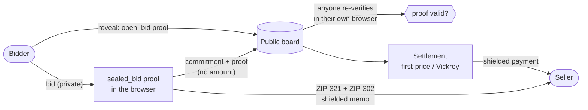

# ZecPass — sealed-bid auctions on Zcash, where the price is public and the bidders are not

[](https://github.com/Agozie180/ZecPass/actions/workflows/ci.yml)


**Links:** [60‑second demo](DEMO.md) · [Why this wins](docs/WHY-THIS-WINS.md) · [Security notes](docs/SECURITY.md) · [Deploy your own](#deploy-a-live-demo-in-one-click) · Built for the **Zcash "Zecathon" — Private Markets track**

> **A sealed bid is a zero-knowledge proof: it clears the reserve, it is well-formed, and it cannot be claimed twice — and the amount never leaves the bidder's browser.**

ZecPass runs a sealed-bid auction on Zcash. A bidder proves, in their own browser, that their bid is admissible without revealing it. The sealed bid is published to a shared public board as a commitment, and delivered to the seller inside a shielded Zcash memo. After bidding closes, a bidder reveals their amount with a second proof that it genuinely opens the commitment they sealed. Settlement is a shielded payment.

Two privacy layers do two different jobs, and removing either breaks the design:

- **UltraHonk hides the price.** `sealed_bid` proves `reserve ≤ bid ≤ bound` without revealing the bid and emits a per-auction nullifier so one bidder cannot stuff the ballot; `open_bid` proves a revealed amount opens the sealed commitment.
- **Zcash hides the participants.** Bids reach the seller as a ZIP‑321 request carrying a ZIP‑302 memo; settlement is a shielded payment. Transparent addresses are rejected.

## How it works



1. A seller opens an auction with a public reserve, a pricing rule (first-price or second-price / Vickrey) and a bidding window.
2. A bidder enters an amount — nothing leaves the browser. A Noir circuit, proved with Barretenberg UltraHonk in the browser, shows the bid is in range.
3. The sealed bid — commitment, binding, nullifier and the proof, **never the amount** — is published to the board and delivered to the seller in a shielded ZIP‑321 request.
4. Anyone opens the board and re-checks a sealed bid's proof in their own browser. The server is never trusted with the checking.
5. After bidding closes, a bidder reveals with an `open_bid` proof that the amount opens their commitment. Settlement pays the clearing price to the seller over a shielded payment.

Zcash has no smart contracts, so winner determination and verification happen off-chain, in the browser. That is the correct architecture for this chain, not a gap.

## What's used, and what's deliberately not

| Sponsor surface | Used | Evidence, or the reasoned decision |
| --- | :---: | --- |
| Noir circuits (`sealed_bid`, `open_bid`) | ✅ | `circuits/`, `nargo test` 7/7 + 5/5 |
| Barretenberg UltraHonk (`@aztec/bb.js`) | ✅ | real prove **and** verify in-browser (`lib/proof/auction-proofs.ts`) |
| ZIP‑321 payment requests | ✅ | delivery + settlement URIs with QR (`lib/zcash/zip321.ts`) |
| ZIP‑302 text memo | ✅ | sealed-bid envelope, kept ≤ 512 bytes (`lib/zcash/sealed-bid.ts`) |
| Unified + Sapling shielded addresses | ✅ | checksum-validated; transparent addresses rejected (`lib/zcash/address.ts`) |
| Zcash smart contracts | ❌ | Zcash has none by design — verification and settlement are off-chain/in-browser |
| On-chain settlement confirmation | ❌ (reasoned) | no contract to read it; confirming a shielded payment needs the seller's viewing key + a light client (see `docs/SECURITY.md`) |

## The thesis, enforced (not asserted)

| The system decides | The system is structurally prevented from deciding |
| --- | --- |
| whether a bid is admissible — **by proof, not trust** | a bid below the reserve is **unprovable** (`assert(bid >= reserve)`) |
| whether a reveal is truthful — **by proof, not trust** | a reveal that does not open the sealed commitment is **unprovable** |
| — | the same bidder identity being counted twice on an auction (per-auction **nullifier**; one person may hold several identities — see [Security](docs/SECURITY.md)) |

You can watch all three refuse, live, in the Playground (`/playground`).

## Measured

| Claim | Value | Reproduce |
| --- | --- | --- |
| `sealed_bid` circuit tests | 7 / 7 pass | `npm run circuit:test` |
| `open_bid` circuit tests | 5 / 5 pass | `npm run circuit:test` |
| TypeScript unit tests | 50 pass | `npm test` |
| Sealed-bid proof size | ~14.6 KB | seal a bid in `/playground` |
| In-browser prove **+** verify | ~10–25 s cold, faster once the CRS caches | `/playground` |

## Run it

```bash
npm install          # postinstall vendors @aztec/bb.js into public/vendor
npm run dev          # http://localhost:3000 — testnet by default, no .env needed
```

Checks: `npm run typecheck`, `npm run lint`, `npm test`. Proving fetches the Barretenberg CRS from `crs.aztec.network` on first use, so the browser needs internet.

## Deploy a live demo in one click

The Playground and the seeded board are fully client-side, so they work on any host; the board's write actions degrade gracefully on a read-only/serverless filesystem (temp dir, then in-memory).

[](https://vercel.com/new/clone?repository-url=https://github.com/Agozie180/ZecPass)

**Shared, persistent board on Vercel:** add a KV store so posted bids persist and are shared across visitors and serverless instances. In the Vercel dashboard → Storage, add **Upstash for Redis** (or Vercel KV) — it sets `KV_REST_API_URL` and `KV_REST_API_TOKEN` automatically; redeploy and the board uses them (it also accepts `UPSTASH_REDIS_REST_URL` / `UPSTASH_REDIS_REST_TOKEN`). Without a KV store the Playground and the seeded board still work, but bids posted on a serverless host are per-instance and may not persist. Add your URL here once deployed: **Live demo:** _(add after deploying)_.

## The circuits

Both are Noir `1.0.0-beta.9`, proved and verified with UltraHonk. `sealed_bid` proves `reserve ≤ bid ≤ bound` and emits `commitment` / `bidder_binding` / `nullifier`; `open_bid` proves a revealed amount opens the commitment. Full detail and the public-input ordering are in [`circuits/README.md`](circuits/README.md).

## Layout

| Path | What is there |
| --- | --- |
| `app/` | landing, `/playground`, `/create`, `/auctions/[id]`, board API routes |
| `components/` | board, create form, auction room, playground, theme toggle |
| `lib/proof/` | browser UltraHonk proving, shared field primitives, per-browser secrets |
| `lib/zcash/` | network registry, address validation, ZIP‑302 memo, ZIP‑321, sealed-bid envelope |
| `lib/domain/` | auction model: lifecycle, first-price and Vickrey resolution |
| `lib/board/` | public board store + committed demo seed |
| `circuits/`, `artifacts/noir/` | the two circuits, tests, and compiled artifacts |

## Known limits (stated plainly)

Full detail in [`docs/SECURITY.md`](docs/SECURITY.md). In short: publishing a sealed bid to the board is a clearnet HTTP POST, so the board host sees the bidder's IP — the ZK hides the amount and Zcash hides the bidder→seller delivery, but board-level network anonymity needs Tor; there is no deposit/escrow and reveal is voluntary; the board cannot confirm a settlement payment landed; the demo is testnet; nothing is audited.

## For judges

Start with [`DEMO.md`](DEMO.md) — a 60-second walkthrough. Fastest path: `npm install && npm run dev`, open `/playground`, seal a bid, then **try to cheat** (bid below the reserve, or reveal a different number) and watch the circuit refuse. Then the pre-seeded board at `/` lets you verify a sealed bid's proof, reveal, and settle. The case against the four judging axes is in [`docs/WHY-THIS-WINS.md`](docs/WHY-THIS-WINS.md).

## License

MIT
